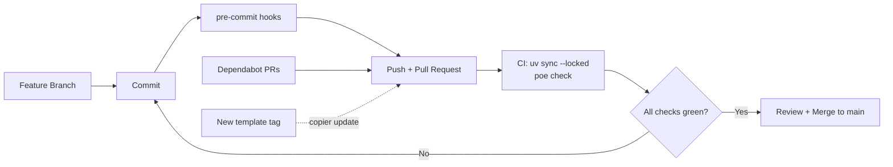

# de-python-template

[](https://github.com/pavanmummasani/de-python-template/actions/workflows/template-ci.yml)

Data Engineering Python project template (Copier) with locked environments,
typed configuration, secret scanning and automated quality gates in
pre-commit and GitHub Actions.

## Overview

This template generates the standard foundation for data engineering Python
projects such as ingestion jobs (dlt), orchestration code (Dagster) and
pipeline utilities for Snowflake and Databricks. It is built from
[scientific-python/cookie](https://github.com/scientific-python/cookie), with
library-publishing parts removed and data engineering basics added.

- **Reproducible environments**: uv with a pinned `.python-version` and a
  committed `uv.lock`; CI installs with `uv sync --locked`
- **Typed configuration**: settings loaded from environment variables and
  `.env` through pydantic-settings, validated at startup
- **Secrets kept out of git**: `.env` is ignored, `.env.example` documents
  every setting, detect-secrets blocks commits that contain keys, and
  TruffleHog scans every push and pull request in CI
- **Automated quality gates**: Ruff (including security rules), mypy strict,
  pytest with an 80% coverage gate, and sp-repo-review
- **One command, same as CI**: `uv run poe check` runs every CI check locally
- **Supply-chain hygiene**: Dependabot for Actions, pre-commit hooks and uv;
  zizmor audits workflows; jobs run with least-privilege permissions
- **Template updates**: generated projects pull new template releases with
  `copier update`
- **Decision records**: every departure from the standard is documented in
  `docs/decisions/`

## Repository Structure

```text
de-python-template/
├── .github/
│   ├── workflows/
│   │   └── template-ci.yml           # Self-test: generate sample per Python version, run all checks
│   ├── dependabot.yml                # Action and hook updates for this repo and the template
│   └── zizmor.yml                    # Workflow security audit settings
├── docs/
│   └── decisions/                    # Decision records for the template design
├── template/                         # Everything below is rendered into a new project
│   ├── .github/
│   │   ├── workflows/ci.yml          # Project CI: uv sync --locked, then poe check
│   │   ├── dependabot.yml            # Actions, pre-commit hooks and uv updates
│   │   └── zizmor.yml
│   ├── docs/decisions/               # Project decision records (starts with 0000)
│   ├── src/{{package_name}}/
│   │   ├── config.py                 # Typed settings (pydantic-settings)
│   │   ├── errors.py                 # ProjectError base class and subclasses
│   │   └── logging_setup.py          # configure_logging() for entry points
│   ├── tests/                        # pytest tests for the starter modules
│   ├── .vale/styles/Slop/            # Prose rules: buzzwords, filler, em dashes
│   ├── .vale.ini                     # Vale prose linter settings
│   ├── .env.example                  # Every setting, no real values
│   ├── .gitattributes                # LF line endings on every OS
│   ├── .pre-commit-config.yaml       # Fast commit-time checks
│   ├── .secrets.baseline             # detect-secrets baseline
│   ├── pyproject.toml.jinja          # Dependencies, tool configuration, poe tasks
│   └── README.md.jinja               # Project README with its own Standards table
├── .gitattributes                    # LF line endings on every OS
├── .pre-commit-config.yaml           # Docs, prose, spelling and workflow checks for this repo
├── .vale.ini                         # Reuses the template's Vale rules
├── CHANGELOG.md                      # Changes per template version
├── copier.yml                        # Template questions and validation
├── LICENSE
└── README.md
```

Files ending in `.jinja` are rendered with the answers to the template
questions; all other files are copied as they are.

## Getting Started

### For Data Engineers

**Prerequisites:** [uv](https://docs.astral.sh/uv/) and Git. uv installs
Python and every other tool. On Windows, run
`git config --global core.autocrlf input` once, so files keep LF line
endings.

1. Generate a new project:

   ```bash
   uvx copier copy gh:pavanmummasani/de-python-template my-project
   cd my-project
   ```

   Answer the four questions (see [Template Questions](#template-questions)).

2. Set up the environment (one time per clone):

   ```bash
   git init                      # skip if the folder is already a repo
   uv lock                       # first time only; commit uv.lock
   uv sync                       # creates .venv with all dev tools
   uv run pre-commit install     # runs fast checks on every commit
   ```

3. Configure local settings:

   ```bash
   cp .env.example .env
   # Edit .env and fill in values. .env is git-ignored.
   ```

4. Create a feature branch:

   ```bash
   git checkout -b feature/your-feature-name
   ```

5. Develop:
   - Add code under `src/<package_name>/` and tests under `tests/`.
   - Add each new setting to `config.py` **and** `.env.example` together.
     Use `SecretStr` for keys and passwords.
   - Raise subclasses of `ProjectError` from `errors.py`.
   - Call `configure_logging()` once in entry points; elsewhere use
     `logging.getLogger(__name__)`.

6. Run every check locally:

   ```bash
   git add -A                    # pre-commit only checks files git tracks
   uv run poe check              # lint, types, tests, repo-review
   ```

7. Commit, push and open a pull request:

   ```bash
   git commit -m "Add FRED rates loader"
   git push -u origin HEAD
   ```

   Pre-commit runs on the commit; CI runs the full check on the PR.

8. **Merge**: once CI is green and the PR is approved, merge to `main`.

### For Template Maintainers

One-time setup after creating the repository on GitHub:

1. **Protect `main`**: require a pull request and the status checks from
   `Template self-test` (the repo lint job, the secret scan, and one sample
   job per Python version), and block force-pushes.
2. **Turn on security features** under **Settings → Code security**:
   Dependabot alerts and security updates, secret scanning, and push
   protection (blocks pushes that contain known key types).
3. **Release a version** so projects can generate from it and update to it:

   ```bash
   git tag v0.1.0
   git push origin v0.1.0
   ```

   Use semantic versions, and move the `[Unreleased]` entries in
   `CHANGELOG.md` under the new version first. Projects pick up the newest
   tag on `copier copy` and `copier update`.

Apply the same branch protection to every generated project, requiring the
`Lint, types, tests, repo-review` and `Secret scan (TruffleHog)` checks, and
turn on the same security features.

## Configuration

### Template Questions

| Question         | Default                         | Validation                                 |
| ---------------- | ------------------------------- | ------------------------------------------ |
| `project_name`   | `my-data-project`               | Lowercase letters, digits and hyphens      |
| `package_name`   | `project_name` with `_` for `-` | Valid Python identifier, not a keyword     |
| `github_owner`   | none (required)                 | Valid GitHub user or organization name; used in the CI badge |
| `python_version` | `3.12`                          | `3.12` or `3.13`                           |

Answers are saved in the project's `.copier-answers.yml` and reused by
`copier update`.

### Application Settings (`.env`)

`config.py` reads settings from environment variables first, then `.env`.
Names are case-insensitive. Invalid or missing values raise `ConfigError` at
startup.

```dotenv
# dev or prod
APP_ENV=dev

# DEBUG, INFO, WARNING, ERROR or CRITICAL
LOG_LEVEL=INFO

# Add secrets as SecretStr fields in config.py, then list them here empty:
# EXAMPLE_API_KEY=
```

### GitHub Secrets

None are required. Generated CI uses only the default `GITHUB_TOKEN`, with
read-only access. Add repository or organization secrets only when a project
needs them, and pass them to steps through `env:`, not inline expressions.

### Tool Configuration (`pyproject.toml`)

| Section                 | Controls                                                  |
| ----------------------- | --------------------------------------------------------- |
| `[project]`             | Name, Python requirement, runtime dependencies            |
| `[dependency-groups]`   | Dev tools: mypy, poe, pre-commit, pytest, sp-repo-review  |
| `[tool.poe.tasks]`      | `lint`, `types`, `test`, `review`, `check`                |
| `[tool.pytest]`         | Strict mode, warnings as errors, test paths               |
| `[tool.coverage]`       | Source package, `fail_under = 80`                         |
| `[tool.mypy]`           | Strict mode and extra error codes                         |
| `[tool.ruff.lint]`      | Rule sets, including `S` (security) and `DTZ` (timezones) |
| `[tool.repo-review]`    | Checks skipped on purpose, each with its reason           |

## Workflow Overview



### Workflow Triggers

| Event                                   | Workflow / tool                  | Description                                                  |
| --------------------------------------- | -------------------------------- | ------------------------------------------------------------ |
| `git commit`                            | pre-commit                       | Ruff, mypy, detect-secrets, hygiene, spelling, schemas, zizmor |
| Pull request opened or updated          | `ci.yml` (project)               | `uv sync --locked`, then `uv run poe check`; TruffleHog secret scan in a parallel job |
| Push to `main`                          | `ci.yml` (project)               | Same as pull request                                         |
| Manual dispatch                         | `ci.yml` / `template-ci.yml`     | On-demand rerun                                              |
| Pull request or push to `main` (template) | `template-ci.yml`              | Lints this repo's docs and workflows; generates a sample per Python version and runs all checks |
| Weekly                                  | Dependabot                       | Grouped update PRs for Actions, hooks and uv (7-day cooldown) |

## Detailed Workflow Stages

### 1. Commit (pre-commit)

Fast checks run only on staged files and block the commit on failure:

1. File hygiene: large files, merge markers, trailing whitespace, YAML/TOML syntax
2. Ruff lint (with auto-fix) and Ruff format
3. mypy strict, run from the locked project environment
4. detect-secrets against `.secrets.baseline`
5. Markdown structure (pymarkdown) and prose rules (Vale: buzzwords,
   filler phrases, em dashes)
6. codespell, `pyproject.toml` and workflow schema validation, zizmor

Tests do not run here, so commits stay fast.

### 2. Continuous Integration

`ci.yml` installs the exact locked environment and runs `uv run poe check`:

| Task     | Runs                                              |
| -------- | ------------------------------------------------- |
| `lint`   | Every pre-commit hook on all files (except mypy) |
| `types`  | mypy strict on `src/` and `tests/`               |
| `test`   | pytest with coverage; fails under 80%; skips tests marked `integration` |
| `review` | sp-repo-review against the Scientific Python guide |

### 3. Dependency Updates

Dependabot opens one grouped PR per ecosystem each week, after a 7-day
cooldown. CI validates each update like any other change.

### 4. Template Updates

When a new template version is tagged, update a project from a clean
working tree:

```bash
uvx copier update --defaults
uv lock && uv run poe check
```

Copier applies a three-way merge and marks any conflicts inline for review.

## Standards

| Practice           | Standard                                          | Enforced by                                            |
| ------------------ | ------------------------------------------------- | ------------------------------------------------------ |
| Project layout     | Scientific Python development guide               | `sp-repo-review` in CI                                 |
| Dependencies       | uv with a committed lock file                     | `uv sync --locked` in CI                               |
| Lint and format    | Ruff, including security rules (`S`)              | pre-commit and CI                                      |
| Types              | mypy strict                                       | pre-commit and CI                                      |
| Tests              | pytest strict mode, coverage at least 80%         | CI                                                     |
| Docs and prose     | Markdown structure, no buzzwords or filler        | pymarkdown and Vale in pre-commit and CI               |
| Secrets            | `.env` only, never in code                        | detect-secrets (commit), TruffleHog (CI), GitHub push protection |
| Workflow security  | Least-privilege permissions, zizmor audit         | pre-commit and CI                                      |
| Dependency updates | Dependabot, weekly, 7-day cooldown                | GitHub                                                 |
| Template integrity | Generate per Python version, run all checks       | [`template-ci.yml`](.github/workflows/template-ci.yml) |
| Decisions          | Nygard decision records                           | [`docs/decisions/`](docs/decisions)                    |

### Architecture Decisions

| No.  | Decision                                                                                                 |
| ---- | -------------------------------------------------------------------------------------------------------- |
| 0001 | [Base the template on scientific-python/cookie](docs/decisions/0001-base-on-scientific-python-cookie.md) |
| 0002 | [Drop library publishing, docs site and nox](docs/decisions/0002-drop-library-publishing.md)             |
| 0003 | [Pre-commit runs fast checks only](docs/decisions/0003-pre-commit-scope.md)                              |
| 0004 | [uv with a lock file; Python 3.12 by default](docs/decisions/0004-uv-and-python-3-12.md)                 |
| 0005 | [Generated-project CI on Linux with one Python version](docs/decisions/0005-linux-only-ci.md)            |
| 0006 | [poe as the task runner](docs/decisions/0006-poe-task-runner.md)                                         |
| 0007 | [Lint Markdown structure and prose](docs/decisions/0007-markdown-and-prose-linting.md)                   |
| 0008 | [Force LF line endings](docs/decisions/0008-force-lf-line-endings.md)                                    |
| 0009 | [Layered secret scanning](docs/decisions/0009-layered-secret-scanning.md)                                |

## Troubleshooting

### Common Issues

#### Pre-commit reports "(no files to check)"

- pre-commit only sees files git tracks. Run `git add -A` first.

#### `uv sync --locked` fails in CI

- `uv.lock` is missing or out of date. Run `uv lock` and commit the result.

#### Commit blocked by detect-secrets

- Move the value into `.env` and read it through `config.py`.
- For a confirmed false positive, add `# pragma: allowlist secret` to the
  line.

#### Commit blocked by Vale or pymarkdown

- Vale names the word or phrase; rewrite the sentence in plain terms.
- To change the rules, edit `.vale/styles/Slop/` and record why in
  `docs/decisions/`.

#### `ConfigError: Invalid settings` at startup

- Compare `.env` with `.env.example`. Check spelling and allowed values
  (for example `APP_ENV` must be `dev` or `prod`).

#### Secret scan fails

- A found key is live, or its live check errored: revoke the key at the
  provider, then remove it from history.
- After a deliberate history rewrite on `main`, the push's starting commit
  no longer exists and the scan errors. Rerun the workflow manually.
- "action is vX but scanner version is Y": set the `version:` line next to
  the TruffleHog action to the same number.

#### Coverage below 80%

- Add tests for the uncovered lines listed in the `test` task output.

#### Conflicts after `copier update`

- Resolve the inline conflict markers, then run `uv lock` and
  `uv run poe check`.
- Whole files marked as changed on Windows usually mean CRLF line endings.
  Follow the 0.1.2 upgrade notes in `CHANGELOG.md`.

#### "mixed line ending" fails on Windows

- Files were written with CRLF. Set `git config --global core.autocrlf input`,
  commit, then run `git rm --cached -r -q . && git reset --hard` to rewrite
  them with LF.

### Debug Commands

```bash
# List available tasks
uv run poe

# Run a single check
uv run poe types
uv run poe test -k config        # extra arguments go to pytest
uv run poe test-integration      # tests that call real APIs or databases

# Run one pre-commit hook on all files
uv run pre-commit run ruff-check --all-files

# Show what copier update would change, without writing
uvx copier update --defaults --pretend
```

## Developing the Template

To test a change, generate a sample outside the repository and run every
check, the same way `template-ci.yml` does (Linux, macOS or Git Bash):

```bash
uvx copier copy --defaults --vcs-ref HEAD -d github_owner=example-org . /tmp/sample
cd /tmp/sample && git init -q && uv lock && uv sync --locked && git add -A
uv run poe check
```

Add `-d python_version=3.13` to test 3.13. Keep `--vcs-ref HEAD`: without
it, Copier renders the newest tag instead of your change. With it, Copier
renders the latest commit plus any uncommitted changes.

This repo's own docs are checked by `uvx pre-commit run --all-files` at the
repository root.

## Additional Resources

### Project Documentation

- [Changelog](CHANGELOG.md): what changed in each template version
- [Decision records](docs/decisions): why the template departs from cookie
- [Generated project README](template/README.md.jinja): what each project receives

### External Resources

- [Scientific Python development guide](https://learn.scientific-python.org/development/)
- [scientific-python/cookie](https://github.com/scientific-python/cookie)
- [Copier documentation](https://copier.readthedocs.io/)
- [uv documentation](https://docs.astral.sh/uv/)
- [Ruff rules](https://docs.astral.sh/ruff/rules/)
- [pydantic-settings](https://docs.pydantic.dev/latest/concepts/pydantic_settings/)
- [pre-commit](https://pre-commit.com/)

## Contributing

Changes to the template follow the same quality bar as the projects it
generates:

- Edit files under `template/` and prove the change with a generated sample
  (see [Developing the Template](#developing-the-template)).
- A change that departs from cookie or the Scientific Python guide ships
  with a decision record in `docs/decisions/`.
- Merges to `main` require a green `Template self-test` for every Python
  version.
- Every change adds a line under `[Unreleased]` in `CHANGELOG.md`.
- Releases are tagged with semantic versions so generated projects can
  update with `copier update`.

## License

Released under the [MIT License](LICENSE).
